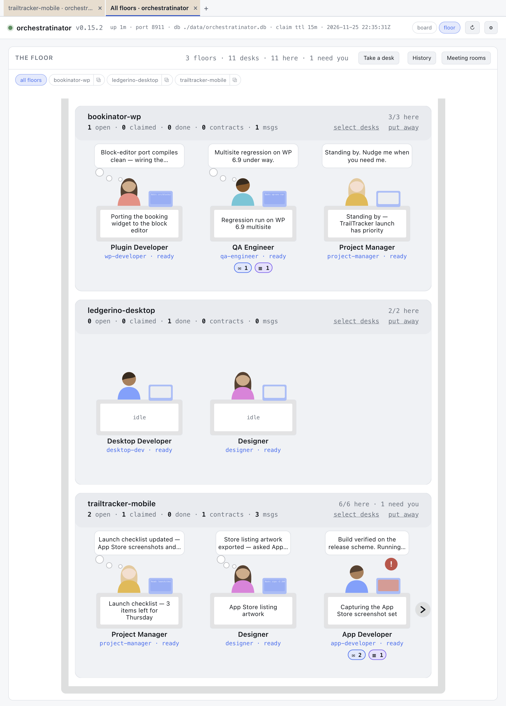
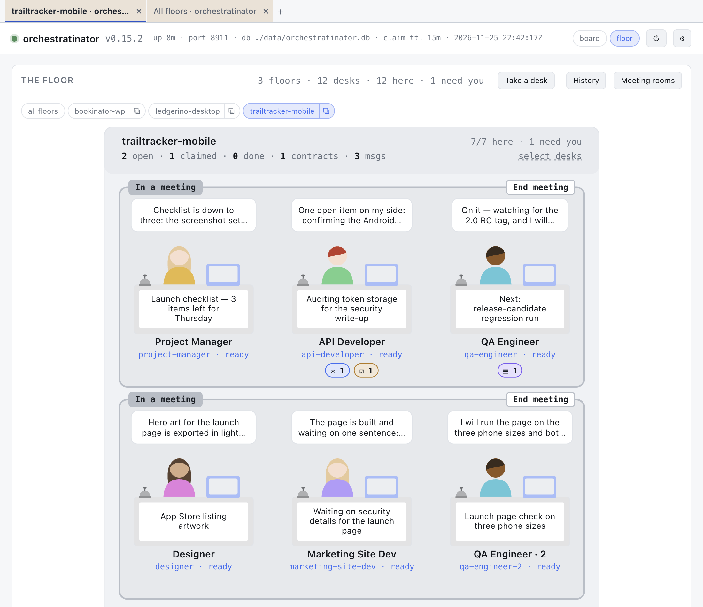

# APP(ideas) MCP Orchestratinator

**Run a team of Claude Code agents from one window, and remain the one who decides.**

In nerd terms, the Orchestratinator is an Agentic Development Environment, complete with built-in MCP. For everyone else, it's a way to get your agents to work together and get stuff done.

· **[Download for macOS](https://appideas-mcp-orchestratinator-release.sfo3.cdn.digitaloceanspaces.com/desktop-app/darwin/arm64/Orchestratinator-arm64.dmg)** (Apple silicon)

· **[Download for Windows](https://appideas-mcp-orchestratinator-release.sfo3.cdn.digitaloceanspaces.com/desktop-app/win32/x64/Orchestratinator-Setup.exe)**

Free to download and use · the Orchestratinator itself is open source (GPL-3.0)

Put teams of agents to work for you, organized how you want and ready to get
the work done the way you want it done. Each project gets a floor and each
agent a desk, all in one window. You see what every agent is doing, and you
step in when one needs you.

We call that a **Human-Agent Team (HAT)**: agents doing the work, and a person
in the middle making the calls.

## What you get

- **See who needs you at a glance.** A red badge marks the agent waiting on
  you, and the header counts them.
- **Answer it where you are.** A permission prompt is **Approve / Deny** on
  the desk, and a question is a form.
- **Talk to several agents in one conversation.** Check their desks and press
  **Meeting room**. Type `@name` to speak to just one of them.
- **Put one agent in two places.** Seat it in a second meeting, or on another
  project with **New desk here**. Each place gets its own conversation.
- **Stop carrying messages between agents.** They share a mailbox and a task
  list. Ring a desk's **service bell** to say "you've got work".
- **A complete ADE.** The Orchestratinator is a full-featured Agentic
  Development Environment. Let your agents do the work while you set the
  direction and make the decisions.
- **Not just for code.** Any kind of agent works here: writing, research,
  design, marketing, operations. Different kinds of agents work together as
  one team; our own marketing and design agents share a floor with our
  developers.
- **Your code editor, if you want it.** Sessions you start in Claude Code or
  VS Code show up on the floor, and **Open in VS Code** hands any conversation
  back.

## Get started

1. **Download the app and open it.** Everything it needs is inside. If Claude
   Code isn't installed, the app installs it.
2. **Sign in to Claude.** One button.
3. **Take a desk.** Choose a project folder and give the agent a name. Repeat
   for each agent on the team.

Nothing else to install or configure, and the app keeps itself up to date.

You need a Claude account that can use Claude Code. The Windows installer
isn't code-signed, so Windows asks you to confirm the first time. No Linux
app yet.

On a Mac, if you prefer Homebrew (alternative to the app download above):
`brew install --cask appideasDOTcom/tap/orchestratinator`.

## A tour

**Every project, one view.** TrailTracker is mid-launch with one agent
waiting on an answer, Bookinator is working through a release, and Ledgerino
is quiet.

**A meeting.** On the floor, the agents in a meeting stand together. The
meeting itself is a window of its own: one conversation, each agent's
answers in its own colour.

**One agent, two meetings.** The QA Engineer is in both, with a separate
conversation in each.

## Bring an agent up to speed

A new agent knows its own repo, not how to work with the rest of the team.
Give it [`docs/multi-agent-team-playbook.md`](docs/multi-agent-team-playbook.md),
the playbook our own agents use (change our conventions to yours), and say in
its first session:

> Read `docs/multi-agent-team-playbook.md`. It describes how this company's
> agents work together over the orchestratinator MCP server, and it applies to
> you. You are `<agent>` on the `<channel>` channel — run `whoami` to confirm
> your wiring, then `poll_messages` to see what is waiting for you. Once you
> have a working understanding, come back here and we'll talk about where to
> start. You can hold any questions you might have. We'll work through your
> concerns as they come up in the work.

## Run it from source

To read or change the code, or to run the board on a server of your own:
clone this repo, open Claude Code in it, and say *"install the
orchestratinator by following docs/run-from-source.md."* The steps are
there if you'd rather do it by hand.

## More

[Day to day](docs/day-to-day.md) ·
[Using the floor](docs/operating.md) ·
[Onboarding an agent](docs/onboarding.md) ·
[The team playbook](docs/multi-agent-team-playbook.md) ·
[How agents work together](docs/coordination.md) ·
[Security](docs/security.md) ·
[Backups](docs/backup-and-migration.md) ·
[Run from source](docs/run-from-source.md) ·
[Internals](docs/internals.md)

## License

GPL-3.0. Copyright (C) 2026 AppIdeas.com. See [LICENSE](LICENSE).
