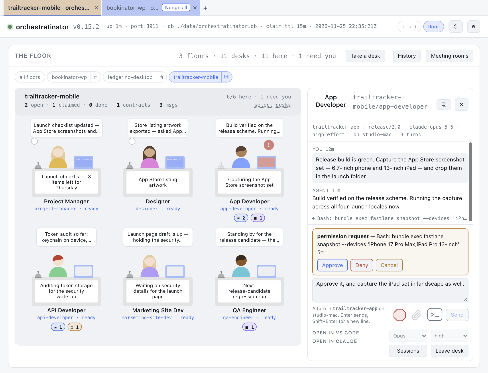
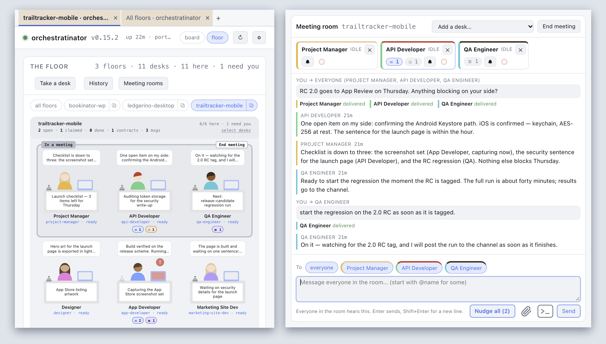

# APP(ideas) MCP Orchestratinator

**Run a team of Claude Code agents from one window, and remain the one who
decides.**

**[Download for macOS](https://appideas-mcp-orchestratinator-release.sfo3.cdn.digitaloceanspaces.com/desktop-app/darwin/arm64/Orchestratinator-arm64.dmg)** (Apple silicon)
· **[Download for Windows](https://appideas-mcp-orchestratinator-release.sfo3.cdn.digitaloceanspaces.com/desktop-app/win32/x64/Orchestratinator-Setup.exe)**
· Free download · the Orchestratinator itself is open source (GPL-3.0)



Run Claude Code in five terminals across three projects and most of your day
goes to finding out which one is waiting on you, and to carrying one agent's
answer to another. The Orchestratinator gives each project a floor and each
agent a desk, all in one window. You see which one needs you and answer it
there. The agents message each other, hand each other tasks and agree
contracts in writing, and you can read all of it. The work is theirs; the
decisions stay yours.

We call that a **Human-Agent Team**: agents doing the work, and a person in
the middle making the calls.

## What you get

- **See who needs you at a glance.** Every project is a floor, and every
  agent at work has a desk. A red badge marks the one waiting on you, and the
  header counts them.
- **Answer it where you are.** A permission prompt is **Approve / Deny** on
  the desk, and a question is a form. On a Mac, the bell in the menu bar
  shows what is waiting across every open window and brings any of them
  forward.
- **Talk to several agents in one conversation.** Check their desks and press
  **Meeting room**: one transcript, one composer, and `@names` to speak to
  only some of them. While the room is open, what they broadcast to each other
  stays in the room.
- **Put one agent in several places at once.** An agent already in a meeting
  can join a second one, and **Take a desk → New desk here** seats it on
  another floor. Each gets a conversation of its own, and the one it had
  carries on.
- **Stop carrying messages between agents.** Agents on a project share a
  mailbox, a task list and written contracts. Ring a desk's **service bell**
  to say "you've got work" without typing a word, and an agent with work
  waiting and nothing running is woken with the work named.
- **Keep your editor.** Work in Claude Code or VS Code as you do now: a
  session you start there, in a project on the floor, shows on the floor too.
  On a Mac, **Open in VS Code** or **Open in Claude** hands any conversation
  back from the floor.

And the details that make a day of it easier:

- **Type while it works.** A message to a busy desk joins the turn it's in;
  one sent while it's asking you something waits for your answer.
- **Hand it a file.** Drop, paste or pick one into a desk's box or a meeting
  room.
- **Find any conversation.** **History** searches every conversation on
  every connected computer and reads one whole without resuming it.
- **Several floors at once.** Open each in a window or tab of its own.
- **Holds up when Claude Code updates.** Each desk talks to Claude Code
  through its programmatic interface, not a scraped terminal, and a new
  Claude Code version is probed and flagged if anything changed.

## Get started

**1. Download the app and open it.** It brings everything it runs on: the
board, the host that runs each desk's Claude Code, and the plugin that puts
your sessions on the floor. On a Mac, if Claude Code isn't installed yet, the
app installs it for you.

**2. Sign in to Claude.** One button, finished in your browser. If you're
already signed in, the app skips it.

**3. Take a desk.** Choose a project folder, name the floor and the seat, and
that folder's Claude Code starts there, already on the board. Do it again for
each agent you want on the team.

That is the whole install: no Docker, no Node, no terminal, no config files,
no keys to copy. The app keeps itself up to date: a new version downloads in
the background and installs when you restart it (or at once, with **Restart to
Update**).

**Before you download.** You need a Claude account that can sign in to Claude
Code. The macOS app is for Apple silicon Macs. The Windows installer is not
code-signed, so the first time you run it Windows says it can't verify the
publisher; choose to run it anyway. There is no Linux app yet: the board runs
on Linux [from source](#run-it-from-source), and its desks need a Mac or a PC.
With Homebrew on a Mac:
`brew install --cask appideasDOTcom/tap/orchestratinator`.

## A tour


**The building.** Each floor is a project, each desk an agent. Here the
TrailTracker mobile app is in a launch push with six agents seated and one
needing an answer; the Bookinator WordPress-plugin team is working through a
release; Ledgerino, between releases, is quiet. Agents can hold desks on more
than one floor: this Project Manager drives the TrailTracker launch while
standing by on Bookinator.

**A room** is what the image at the top shows: walk into a floor and each
agent is at a desk, with a thought bubble for what it just said, a sign for
what it's doing, and a red badge on the one that needs you. The panel on the
right is that desk's conversation, live: read it, type into it, answer the
prompt with a click.



**A meeting room.** Who's in the room and what each is doing along the top,
one transcript with each agent's words in its own colour, and one composer. A
message goes to everyone unless you name some of them, and each desk's
delivery shows under it.


**One agent, two meetings.** The QA Engineer is in one meeting room and, as
**QA Engineer · 2**, in another: the same folder, two conversations, each
answering its own room.

**Chats of their own.** **⧉** pops any desk's chat into a window of its own;
keep a few open beside the floor, each one live, and **Re-attach** brings one
back with whatever you'd typed.

## How it fits together

Three parts, and the app carries all three. A **board**: an MCP coordination
server that gives the agents on a project a shared mailbox, task list and
agreed contracts. A **Claude Code plugin**, one install shared by the terminal
and VS Code, that lets each session report what it's doing. And a **host**
that runs each desk's Claude Code so the floor can talk to it. Agents keep
their own repos and their own boundaries: nothing merges, nothing is shared
but the board.

Already running a board in Docker on this computer? On first launch the app
offers to use it instead of its own.

## Onboarding an agent

A desk on the floor is a wired-up repo. It is not yet an agent that knows how to
work with anyone else on the board — that part is one document and one prompt.

The document is
[`docs/multi-agent-team-playbook.md`](docs/multi-agent-team-playbook.md), the
playbook APPideas' own agents are onboarded with, kept here as a worked example
rather than a template. It covers what the tools are actually for, the
difference between addressing a message and delivering one, when an agent
should act alone and when it should stop and ask, how two agents renegotiate a
contract between themselves, what the operator can see on the floor, and the
trigger words that mean something specific. **Read it once yourself before you
hand it on.** The mechanics in it are this server's and will be the same for
you; the conventions are ours — our product names, our free/pro pairing, our
rule that git belongs to the operator alone — and those are the parts to
change.

**Then point the agent at it, in its own repo.** Copy the file into that repo
first: a path an agent can open beats a link it has to go and fetch. In that
repo's first session:

> Read `docs/multi-agent-team-playbook.md`. It describes how this company's
> agents work together over the orchestratinator MCP server, and it applies to
> you. You are `<agent>` on the `<channel>` channel — run `whoami` to confirm
> your wiring, then `poll_messages` to see what is waiting for you. Once you
> have a working understanding, come back here and we'll talk about where to
> start. You can hold any questions you might have. We'll work through your
> concerns as they come up in the work.

The last two sentences do more work than they look like they do, and they are
two separate things.

**Coming back before starting is a gate, and it is worth keeping.** It costs
one exchange and buys you the chance to add the detail this particular agent
needs, and the agent the chance to raise something before it is committed to an
approach.

**Holding questions is not brushing them off.** Roughly four in five of the
questions an agent has at the start get answered by doing the work —
organically, at the moment they matter, at no cost to anyone. The fifth is the
real one, and it arrives later carrying the context that makes it cheap to
answer and hard to misread. Answering all of them up front inverts that: it
spends the most time on the questions with the least information behind them.
The playbook makes the same point in its own voice under **After reading this,
hold your questions**, with the list of the ones that get asked every single
time and need not be.

**How to tell it took.** The agent should come back having run `whoami` and
`poll_messages` rather than asking you what it is called, and should set a
status, so its sign stops reading `idle`. Once it is working, it addresses
messages to a name instead of broadcasting at the room. If none of that
changed, it read the playbook as background rather than as instructions — say
so plainly and it will correct.

## Day to day

One rule underneath everything: a conversation is one `claude` process, so
**one app holds it at a time**. The floor always says who holds each desk. The
daily loop:

**1. Open a project** in VS Code or Claude Code — any repo that is a desk
(one you took with **Take a desk**, or bound by hand).

**2. Start a session and work as you always have.** The desk comes alive on
its floor: your conversation, state, and prompts appear as they happen. A
repo you bound with a hand-written `.mcp.json` stops its first session on
*"New MCP server found in this project"* — approve it once and that repo is
settled for good. A folder you took with **Take a desk** asks nothing.

**3. Open the app** (or <http://localhost:8787/> on a source install). Glance
at the building; the header counts who's here and who needs you. Go where it
points.

**4. Click into a room, then a desk,** to read that agent's conversation live.

**5. Answer what needs you.** If the floor holds the desk, permission prompts
have **Approve / Deny** buttons right on it. If your editor or a terminal
holds it, the floor shows the question and says to answer it in that app.

**6. Ring the service bell** on any desk whose tray shows waiting messages or
tasks. The agent picks them up. A desk whose Claude Code is not running shows
its bell half-lit: ringing it starts it first — the conversation resumes where
it left off — and then nudges. To nudge several at once, or mark their messages
read, or hide them, use **select desks** on the room's header, check the desks,
and pick the action.

**7. Type to a desk from the floor** by first closing that conversation's tab
in your editor and clicking **Open on the floor** — one app at a time. The
composer comes alive a second or two later; if the desk's Claude Code is not running,
the host starts it and *resumes the same conversation*, history intact.

The composer takes a slash command too: `/clear`, `/compact`, `/btw <question>`
and anything else Claude Code knows, each confirmed by Claude Code's own
receipt and said in its own terms — a new conversation started, compacting,
answered on the side (with the answer). The model and effort controls on
the panel's foot are Claude Code's own `/model` and `/effort`, so a choice is
also **saved as the default for new sessions** on that desk's machine, the
way it is when you change it in Claude Code or your editor. While a
desk compacts, the floor says so, and a message sent meanwhile is taken and
answered when the compaction ends.

**8. Pop a chat out, or bring several desks into one.** **⧉** on a desk's
panel detaches its chat into a window of its own; open as many as you like
beside the floor. To talk to several agents together, **select desks**, check
them, and press **Meeting room**. An agent that is already in a room can be
checked for another, and gets a second session there; **Take a desk → New
desk here** does the same across floors. All of it is in
[Operating the board](docs/operating.md#chatting-with-a-desk).

**9. Take a conversation back whenever you want** — for any feature the floor
chat doesn't provide (on a Mac; not yet tried in the Windows app). **Open in
VS Code** moves it to your editor with everything you did from the floor
already in it; **Open in Claude** opens a terminal of your own `claude` on the
same conversation. Either one takes the conversation from the floor, and the
floor's next message takes it back.

**10. Keep it current.** The app updates itself: a new version downloads in
the background and installs when you restart it. On a source install, the
header shows **Update available** when the branch the board follows has a
commit this build lacks; it checks GitHub once a day. **Update** says what it
will interrupt, then the host on the board's machine fetches the commit,
rebuilds the server, updates the plugin when its hooks changed, and restarts
itself, and the page reloads onto the new build. An update is refused, in
words, when the clone has local changes or is not on the followed branch. One
that stops after the server was rebuilt (the plugin update failed, say) leaves
**Update stopped** in the header, and **Finish the update** runs what is left.
**Settings** (⚙) turns the daily check off, switches to the development
version (`develop` instead of `main`), and has **Check now**. The page's
Update restarts a host that launchd runs (macOS). On Windows, pull the clone
and run `host\install.ps1` again, which stops the running host cleanly and
starts the new one.

## Run it from source

For reading or changing the code, or running the board on a server of its
own. The app above is the quicker way to simply use it. Desks are run by a
host on macOS or Windows; the board itself runs anywhere Docker does.

**The easiest path from source is to have an AI agent do it.** This is a several-part
installation — a server, a plugin, a host — so clone the repo, open a session
in it from Claude Code or VS Code, and say *"install the orchestratinator by
following the README."* Everything below is the manual path, and exactly what
the agent will follow.

Everything here is done once per machine. You need **Docker**,
**Node 24**, and **Claude Code** (the `claude` command) installed and signed
in — the host runs desks with it even if you only ever work from VS Code.
Where you *work* is your choice: start sessions from Claude Code in a
terminal, from VS Code, or both. The floor doesn't replace either — it hands
any conversation back to them whenever you want a feature its chat doesn't
provide. The host — the part that runs each desk's Claude Code for the floor —
runs on **macOS** and **Windows**; the server and the board run anywhere Docker does,
and the plugin wherever Claude Code has a POSIX shell. A desk with no host
behind it is still on the floor with its presence, status, prompts and the
conversation as the plugin's hooks report it, but it is read there, not typed
into.

**1. Get the code and make a shared secret.**

```bash
git clone git@github.com:appideasDOTcom/appideas-mcp-orchestratinator.git
cd appideas-mcp-orchestratinator
node -e "console.log(require('node:crypto').randomBytes(32).toString('base64url'))"
```

Put the generated value in `.env` at the root of this repo:

```ini
ORCH_AUTH_TOKEN=<the generated value>
ORCH_AUTH_MODE=enforce
```

**2. Start the server.**

```bash
docker compose up -d
curl -s localhost:8787/health          # {"ok":true,...}
```

Data lives in a Docker volume and survives rebuilds. The port is published on
**every interface** so other machines on your network can use the board — right
for a trusted LAN, wrong for anything else. To make it this-machine-only,
change the port line in `docker-compose.yml` to `"127.0.0.1:8787:8787"`, and
read [the security model](docs/security.md) before publishing it any wider.

**3. Make each repo a desk.**

A repo joins a floor by declaring itself in its own `.mcp.json` — no central
list, no shared parent folder:

```jsonc
{
  "mcpServers": {
    "orchestratinator": {
      "type": "http",
      "url": "http://localhost:8787/mcp",
      "headers": {
        "X-Channel": "your-project",
        "X-Agent": "this-repo's-role",
        "X-Orchestratinator-Key": "<the ORCH_AUTH_TOKEN from .env>"
      }
    }
  }
}
```

Repos sharing an `X-Channel` share a floor, a mailbox, and a task board. The
`X-Agent` is that repo's seat on it. A directory without a binding is invisible
to the whole system.

**Or skip the file.** Once the host is installed (step 5), **Take a desk** on
the floor does this for you: pick the folder, name the floor and the seat, and
the host binds it in Claude Code's own configuration and starts it there.
No approval dialog, and the key never leaves that machine. A folder that
already has a `.mcp.json` entry is imported the same way. A folder bound to
another instance of the orchestratinator, at another address, is released
from it and seated here on the same click: the dialog names the address it
is leaving before you press. Its conversations come with it; its messages
and tasks stay on the instance it left.

**4. Install the plugin** — this is what puts each session on the floor.

One install covers the whole machine: Claude Code and VS Code share it, so do
this from whichever you work in.

**From Claude Code** (a terminal session), from the clone:

```
/plugin marketplace add ./
/plugin install orchestratinator-floor
```

From any other directory, give the full path to the clone instead of `./`.
Write it with the slash: on Windows a bare `.` is refused ("Invalid
marketplace source format. Try: owner/repo, https://..., or ./path").

**From VS Code**, the `/plugin` command doesn't take arguments — it answers
*"/plugin isn't available in this environment."* Type `/plugin` on its own and
use the menu: add the marketplace by directory, then install
**orchestratinator-floor** from it (it sits at the bottom of the list, below
the official plugins).

There is nothing to configure: the plugin reads each repo's own binding — its
`.mcp.json`, or the local-scope entry `claude mcp add -s local` writes — and
reports state to the same server with the same secret. A repo that doesn't name
the orchestratinator never appears on any floor.

**Updating it later.** The marketplace is the clone itself, but what runs is a
cached copy that does not follow the working tree. After pulling a new
version:

```
claude plugin update orchestratinator-floor
```

(or the same from the `/plugin` menu). Check with `claude plugin list`; the
number should match the one `/health` reports.

**5. Install the host** — this is what lets the floor run and talk to desks.

```bash
./host/install.sh ~/path/to/your/projects
```

Name the directory your repos live under. It finds every desk beneath it,
registers a LaunchAgent so it starts at login, and reads the server address and
shared secret from those desks. If your desks point at more than one board, the
host refuses to guess — name one with
`./host/install.sh --url http://localhost:8787 ~/path/to/your/projects`.

On **Windows**, from PowerShell in the clone:
`powershell -ExecutionPolicy Bypass -File host\install.ps1 C:\path\to\your\projects`.
It registers a task that starts the host at logon (Task Scheduler stands in
for launchd), takes `-Url` and `-Token` like `install.sh`'s `--url` and
`--token`, and `-Uninstall` removes it. One known limit there: when a desk
stops, a command it ran through Git Bash that has detached itself (a dev
server or a watcher started with `exec`) is not stopped with it.

A machine with no hand-bound repo has nothing to read the shared secret from,
and the host needs one to talk to the board and to bind desks from the floor.
Give it the value from `.env` with
`./host/install.sh --token <ORCH_AUTH_TOKEN> ~/path/to/your/projects`. A repo's
own binding wins over it, so a machine with even one `.mcp.json` that writes
the key out needs no `--token`.

A `.mcp.json` that keeps the key out of the tree as `"${ORCH_AUTH_TOKEN}"` is
filled in by Claude Code from your shell, but the host runs as a LaunchAgent,
which starts with none of your exported variables. So `install.sh` takes the
key from the shell you run it in: with `ORCH_AUTH_TOKEN` exported there, no
`--token` is needed, and it is written to the host's own config. Each Claude
Code the host starts for such a repo is given the variable too. Without either, the
host's log says at startup which desk it could not read a key from.

**6. Open the floor.**

Open <http://localhost:8787/> in a browser. The board/floor switch is top
right; every desk you wired up should be there.

### Useful commands

```bash
docker compose up -d                       # start (add --build after code changes)
docker compose down                        # stop; data kept in the volume
docker compose logs -f orchestratinator    # tail
curl -s localhost:8787/health              # is it up?
open http://localhost:8787/                # the page (board/floor switch top right)
npm test                                   # every suite
```

And in any agent's chat window:

```
whoami                       # confirm channel/agent wiring
list_tasks status=open       # what's pending for me
get_contract                 # read the whole agreed interface
```

## Going deeper

The front page stops here; the details — all of them — moved to `docs/`:

| Page | What's in it |
| --- | --- |
| [Operating the board](docs/operating.md) | The board view (presence, status, unread and task counts, the full activity log), presence and status chips, the floor in detail, chats in their own windows, meeting rooms, avatars, saved prompts, stopping a turn, operator actions (view/mark read, close/reassign, move, hide, retire, archive — from either view) |
| [The team playbook](docs/multi-agent-team-playbook.md) | The document you hand a new agent: tools, addressing, autonomy, contracts, what the operator sees on the floor, trigger words — APPideas' own, as an example to modify |
| [How agents coordinate](docs/coordination.md) | Channels, the ten MCP tools, contracts, a typical exchange, wiring up a team, and why human→agent and agent→agent are different mechanisms |
| [The security model](docs/security.md) | The shared secret, the network boundary, what the floor puts on the server, and the sign-in that used to exist |
| [Backups & migration](docs/backup-and-migration.md) | Export, restore, moving the board to a permanent host, cron-driven backups |
| [Internals & development](docs/internals.md) | How it works, the schema, running without Docker, bumping the version, environment variables |

## License

Copyright (C) 2026 AppIdeas.com

This program is free software: you can redistribute it and/or modify it under
the terms of the GNU General Public License as published by the Free Software
Foundation, version 3.

This program is distributed in the hope that it will be useful, but WITHOUT ANY
WARRANTY; without even the implied warranty of MERCHANTABILITY or FITNESS FOR A
PARTICULAR PURPOSE. See the GNU General Public License in [LICENSE](LICENSE)
for details, or <https://www.gnu.org/licenses/gpl-3.0.html>.
