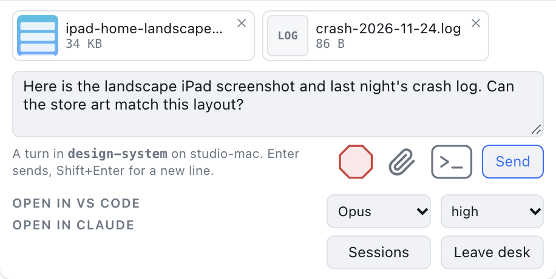
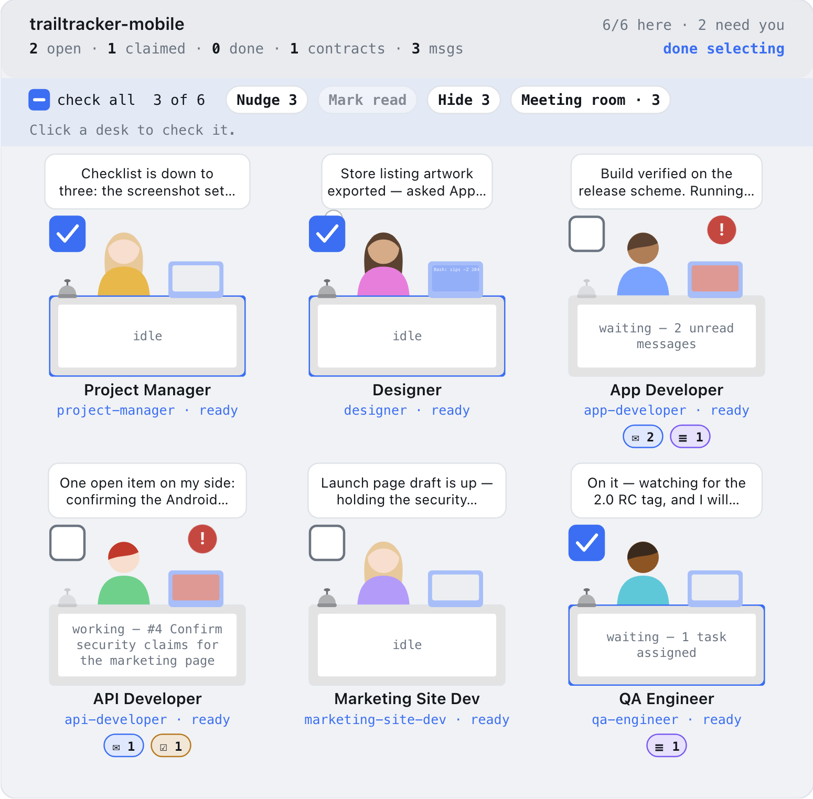

# Day to day

How a normal day with the Orchestratinator goes. Back to the [README](../README.md).

## 1. Open the app

The building shows every project at once. The header tells you how many agents
are at work and how many need you. Start where it points.

## 2. Answer whoever needs you

A red badge marks an agent waiting on you. Click its desk: a permission request
has **Approve** and **Deny**, and a question comes as a form. If Claude Code is
signed out on a computer, its desks show **Sign in**.

## 3. Talk to an agent

Click a desk to open its conversation, and type. You don't have to wait for it
to finish: a message sent while it works joins what it's doing. Drop, paste or
pick a file to hand it one. Slash commands, the model and the effort level work
the way they do in Claude Code.

## 4. Hand out work

Agents share a mailbox and a task list. When a desk's tray shows something
waiting, ring its **service bell** and it picks the work up. If the agent isn't
running, the bell starts it first, right where it left off.

## 5. Bring several agents together

Press **select desks**, check the agents you want, and press **Meeting room**:
one conversation for all of them. Type `@name` to speak to just one.

## 6. Keep more than one thing open

**⧉** pops a desk's chat into a window of its own. Each floor can have its own
window or tab, too.

## 7. Find an earlier conversation

**History** searches your past conversations, and **Sessions** on a desk
reopens one.

## 8. Stay up to date

The app updates itself: a new version installs when you restart it, or right
away with **Restart to Update**. Running from source? See
[Keeping it current](run-from-source.md#keeping-it-current).

## Your editor, if you want it

Everything above happens in the app. If you'd still like a conversation in
your code editor, **Open in VS Code** or **Open in Claude** takes it there, and
your next message from the floor brings it back.
