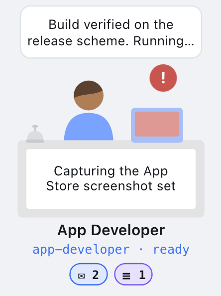

# Onboarding an agent

Back to the [README](../README.md).

A desk on the floor is a wired-up repo. It is not yet an agent that knows how to
work with anyone else on the board — that part is one document and one prompt.

The document is
[`docs/multi-agent-team-playbook.md`](multi-agent-team-playbook.md), the
playbook APPideas' own agents are onboarded with, kept here as a worked example
rather than a template. It covers what the tools are actually for, the
difference between addressing a message and delivering one, when an agent
should act alone and when it should stop and ask, how two agents renegotiate a
contract between themselves, what the operator can see on the floor, and the
trigger words that mean something specific. **Read it once yourself before you
hand it on.** The mechanics in it are this server's and will be the same for
you; the conventions are ours — our product names, our free/pro pairing, our
rule that git belongs to the operator alone — and those are the parts to
change.

**Then point the agent at it, in its own repo.** Copy the file into that repo
first: a path an agent can open beats a link it has to go and fetch. In that
repo's first session:

> Read `docs/multi-agent-team-playbook.md`. It describes how this company's
> agents work together over the orchestratinator MCP server, and it applies to
> you. You are `<agent>` on the `<channel>` channel — run `whoami` to confirm
> your wiring, then `poll_messages` to see what is waiting for you. Once you
> have a working understanding, come back here and we'll talk about where to
> start. You can hold any questions you might have. We'll work through your
> concerns as they come up in the work.

The last two sentences do more work than they look like they do, and they are
two separate things.

**Coming back before starting is a gate, and it is worth keeping.** It costs
one exchange and buys you the chance to add the detail this particular agent
needs, and the agent the chance to raise something before it is committed to an
approach.

**Holding questions isn't brushing them off.** Most of an agent's early
questions answer themselves once it starts working. The ones that don't come
back later, with the context that makes them quick to answer. The playbook
says the same under **After reading this, hold your questions**.

**How to tell it took.** The agent should come back having run `whoami` and
`poll_messages` rather than asking you what it is called, and should set a
status, so its sign stops reading `idle`. Once it is working, it addresses
messages to a name instead of broadcasting at the room. If none of that
changed, it read the playbook as background rather than as instructions — say
so plainly and it will correct. When the floor wakes an agent for waiting
work, it says `nudge`; the playbook tells the agent what that means.

*An agent that read the playbook sets its own status, and its desk sign says so.*
