# Using the floor

Everything you do in the Orchestratinator happens on the floor. This page goes
through it a part at a time. New here? Start with [Day to day](day-to-day.md).
Back to the [README](../README.md).

## The building

Every project is a floor, and the building shows them all at once. The header
counts who's at work and who needs you. An agent needs you when it asks
permission, asks a question, hits an error, or finds Claude Code signed out.

Each desk tells you about its agent at a glance:

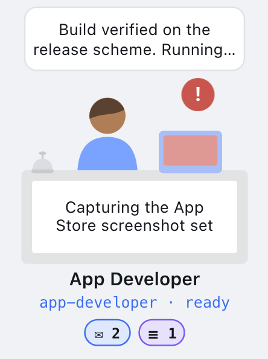

- **The thought bubble** is the last thing it said.
- **The desk sign** is what it says it's doing.
- **The red badge** means it needs you.
- **The tray** holds its unread messages and tasks.
- **The service bell** tells it "you've got work".

A quiet desk is drawn quiet: the floor never guesses that a silent agent is
stuck. A desk with nothing running behind it isn't drawn, and it comes back by
itself when it starts again.

**Several floors at once.** Open any floor in a window or tab of its own with
**⧉** on its name, or **File ▸ New Floor Window**. A tab turns amber when
something on that floor needs you.

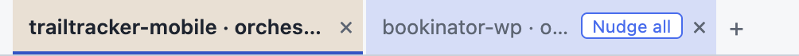

## Taking a desk

**Take a desk** puts an agent on a floor. Choose the project folder, name the
floor and the agent, and its Claude Code starts there.

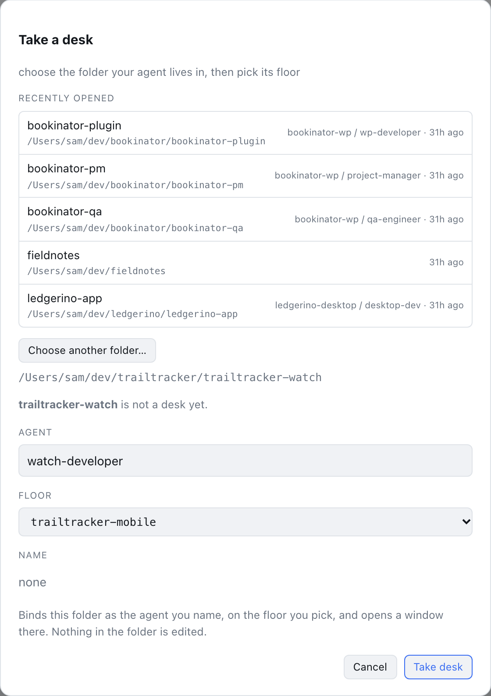

If the folder already has a desk somewhere, the dialog offers **Move to** this
floor,
or **New desk here** to put the same agent on this floor *as well*, with a
conversation of its own. A folder that belongs to another Orchestratinator is
brought over in the same click, and the dialog says so first.

**Leave desk** takes an agent off the floor. The folder and its
conversations stay where they are, and **Take a desk** brings it back.

## Talking to an agent

Click a desk and its conversation opens beside the floor, live. Type and press
Enter. You never have to wait: a message sent while the agent works joins what
it's doing, and one sent while it's asking you something waits until you
answer.

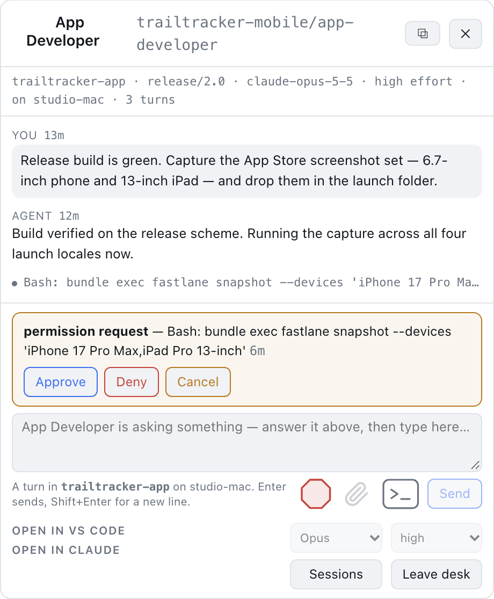

**Permission requests** come with **Approve** and **Deny** (with a box for what
to do instead), **Cancel**, and, when Claude Code offers it, **Yes, and don't
ask again** for that kind of request. Several requests wait in line and come
one at a time; one from a subagent says so.

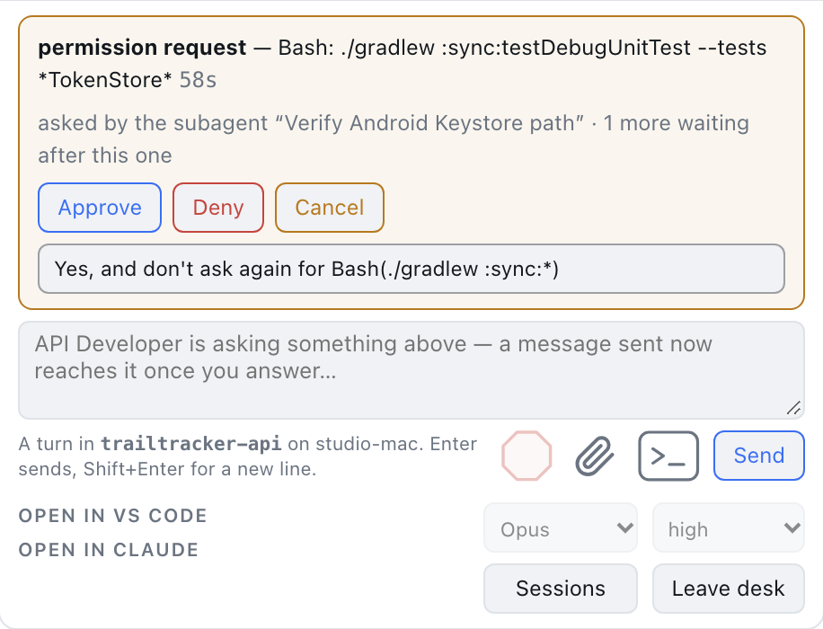

**Questions** come as a form, built from the agent's own question.

**Files.** Drop, paste or pick files into the box to hand them over, in a
desk's conversation or a meeting room.

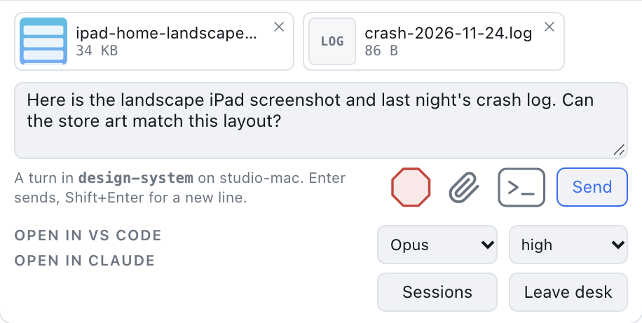

**Slash commands, model and effort** work as they do in Claude Code. The
model and effort you pick become your default for new conversations, and a
new conversation shows them before its first message. The red octagon stops
the agent mid-turn; the conversation shows it was interrupted.

**Signed out?** If Claude Code is signed out on a computer, its desks say so
and offer **Sign in**, which opens Claude's sign-in in your browser.

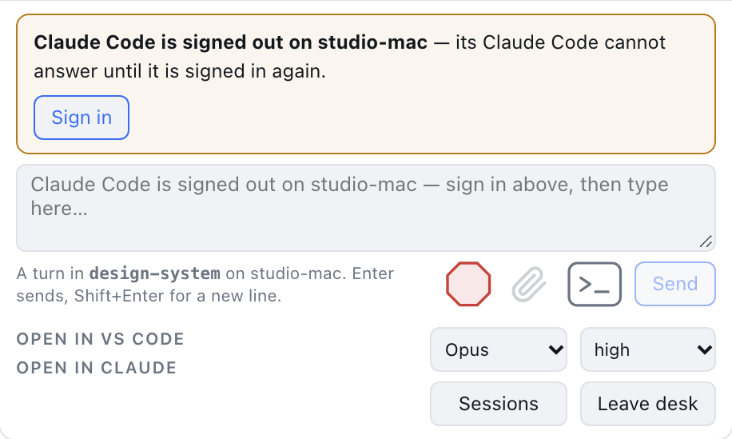

**Sessions** on a desk starts a new conversation or reopens an earlier one.
**Saved prompts**, beside the box, keeps the messages you send over and over.

**Pop a chat out.** **⧉** on a conversation moves it into a window of its own.
Keep a few open beside the floor; each stays live. **Re-attach** brings it back,
with whatever you'd typed.

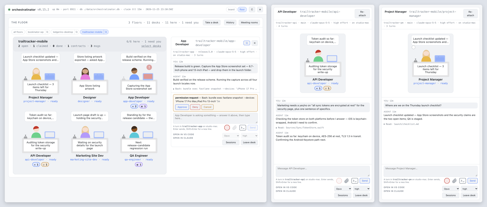

## Meeting rooms

Press **select desks** on a floor, check the agents you want, and press
**Meeting room**. One window holds them all: who's there along the top, one
conversation with each agent's words in its own colour, and one box to type in.
A message goes to everyone; start it with `@name`, or use the chips above the
box, to speak to some of them. Under each message you see it reach each desk.

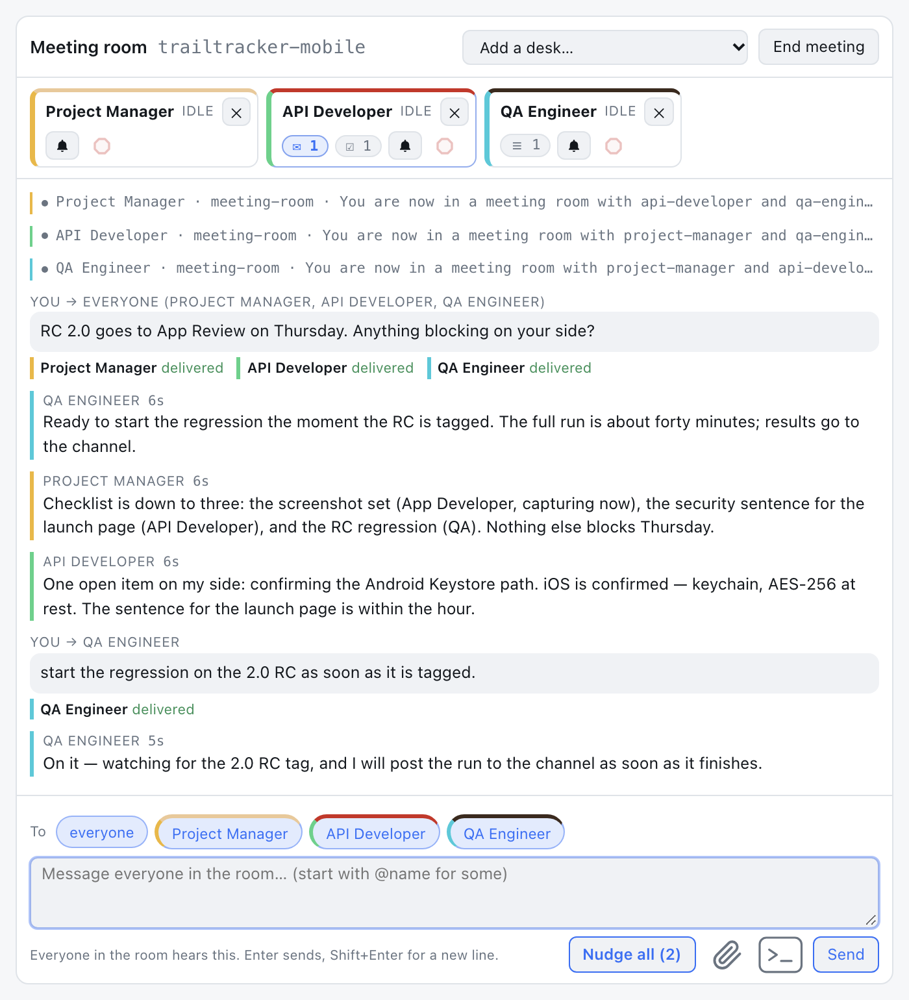

On the floor, the agents in a meeting stand together in an **In a meeting**
box. Click the label to bring the meeting's window forward; **End meeting**
ends it. Each agent is told when it joins and leaves, and while the meeting is
on, what its agents broadcast to each other stays in the room. **Nudge all**
rings every agent in the room that has work waiting.

**One agent in two meetings.** Check an agent that's already in a meeting and
it joins the new one too, as a second session with a conversation of its own.
Its second desk carries a number: **QA Engineer · 2**. The extra session
closes by itself when its meeting ends.

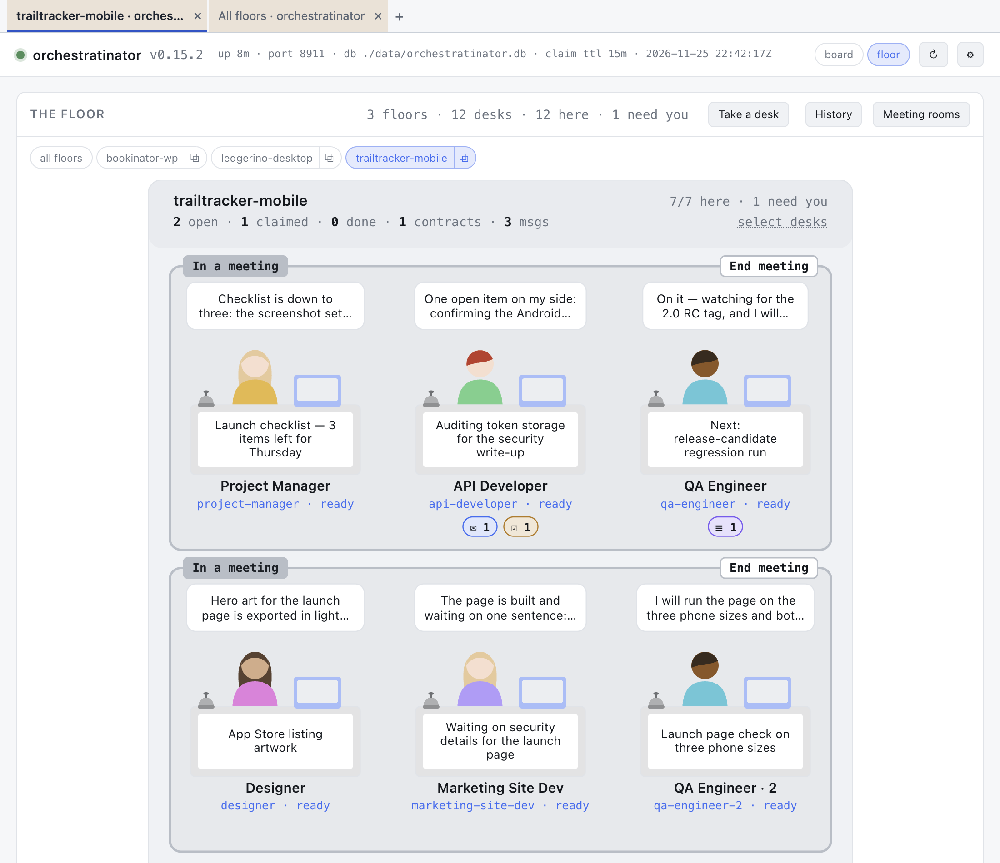

**Meetings keep.** Quit the app and the meeting is still there: its agents stay
in their box, and the room opens again when the app does. **Meeting rooms** in
the floor's header lists recent meetings, and **Resume** reopens one with every
agent back on its conversation.

## Handing out work

Agents on a floor share a mailbox and a task list. When a desk's tray shows
something waiting, ring its **service bell** and the agent picks it up. If it
isn't running, the bell starts it first, where it left off. An agent with work
waiting and nothing running is woken after a minute anyway, with the work named.

**select desks** also acts on several desks at once: **Nudge**, **Mark read**,
or **Hide**.

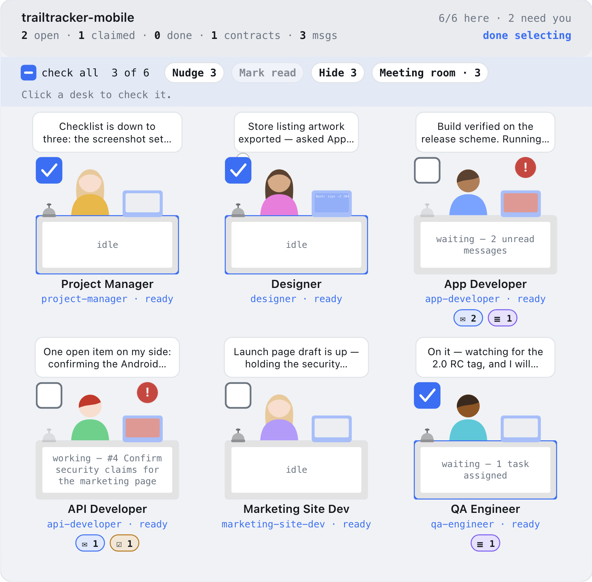

## History

**History** searches your conversations across every connected computer.
Open any one to read it whole, without starting it again.

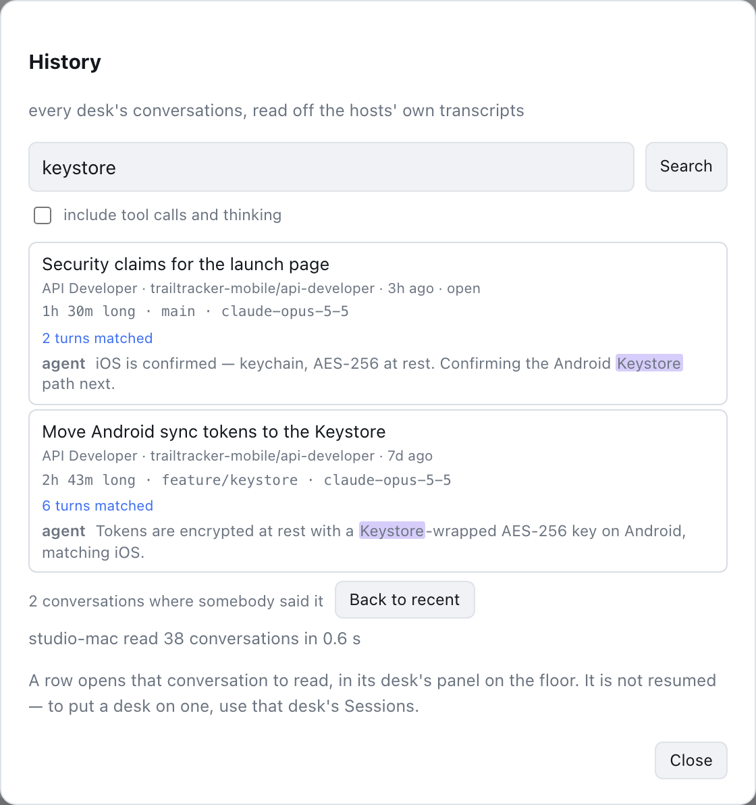

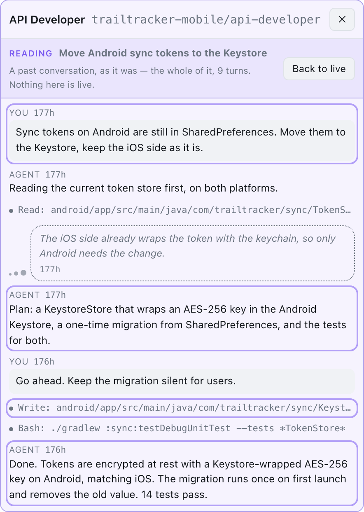

## Keeping the floor tidy

- **Hide desk** (on a desk's nameplate) puts a desk away as a small pill; click
  the pill to bring it back.
- **Move to another floor** moves an agent without hunting for its folder.
- **Edit avatar** renames an agent and changes its look, on every floor it sits.
- **put away** on a floor archives it for everyone. It becomes a pill at the
  bottom of the building, and clicking the pill restores it. It also comes back
  by itself when an agent starts on it.

## The board view

The **board / floor** switch shows the same company as rows: each agent's
presence, its status with how old that status is, and its unread messages and
tasks. Under them, the activity log lists every message, task and contract
change, newest first; click a row to read it in full.

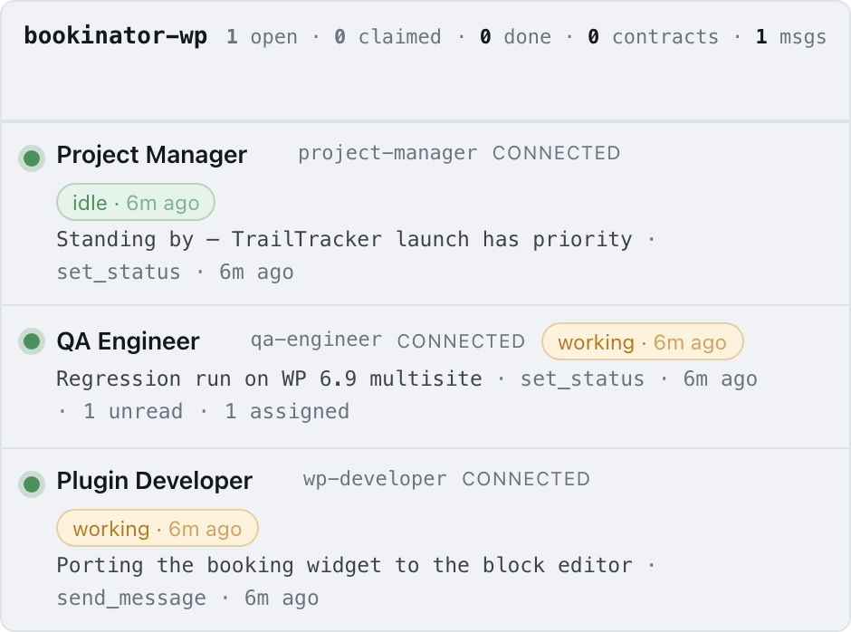

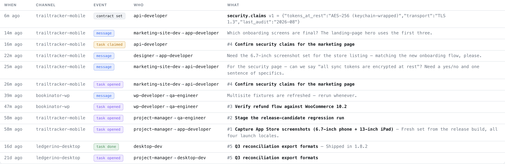

A status an agent sets expires after fifteen minutes, so a crashed agent can't
leave "working" up forever. The board never reads silence as anything.

### What only you can do

Hover an agent on the board and its counts become buttons:

| Action | What it does |
| --- | --- |
| **Mark read** | Clears the agent's unread count. |
| **Close / reassign a task** | Marks it done with a note, or gives it to someone else. Nothing is deleted. |
| **Remove an agent** | Takes it off the board. If it is still running, it comes back by itself. |
| **Archive a channel** | Puts a floor away for everyone; the pill restores it. |
| **Delete a channel** | Permanent, and you type its name to confirm. The activity log keeps the record. |

Every one of these is written to the activity log as yours.

## Settings and updates

The app updates itself: a new version installs when you restart it, or right
away with **Restart to Update**. If a Claude Code update changes something the
floor relies on, a banner at the top of the floor says so.

**Settings** (⚙) holds the app's appearance (light, dark, or follow the
system), where new floors open, auto-refresh, and your backups: export, recover
the whole board, or bring over one floor. See
[Backups & migration](backup-and-migration.md). Running from source? Updating
is in [Run it from source](run-from-source.md#keeping-it-current).

## Your editor, if you want it

**Open in VS Code** or **Open in Claude** moves a conversation to your editor
or a terminal, with everything you did on the floor. Your next message from
the floor brings it back. While an editor has a conversation, its desk says so,
and anything it asks is answered there.
